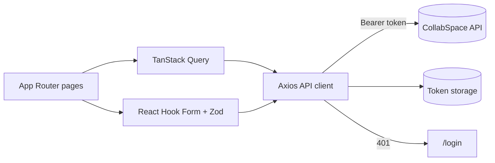

<div align="center">

# 🤝 CollabSpace

**Projects, tasks, meetings and conversations in one workspace for the whole team.**


The web client for the CollabSpace platform, built screen-by-screen from the Figma UI Design frames and wired to the CollabSpace REST API.

</div>

---

## 📖 Table of Contents

- [About](#-about)
- [Features](#-features)
- [Tech Stack](#-tech-stack)
- [Architecture](#-architecture)
- [Project Structure](#-project-structure)
- [Getting Started](#-getting-started)
- [Environment Variables](#-environment-variables)
- [Design & API Scope](#-design--api-scope)
- [Workflow](#-workflow)

---

## 📌 About

**CollabSpace** is a collaborative project-management platform: a team organizes its work into projects, tracks tasks on a kanban board, schedules and joins meetings, shares files, and talks in built-in chats, with reports, notifications and an AI assistant on top.

This repository is the frontend. Every screen is implemented from the product's Figma hi-fi frames. Controls are wired to the backend wherever the API actually serves them; where it does not, they stay visibly disabled with the reason on the control.

---

## ✨ Features

| Feature | Description |
| --- | --- |
| 🔐 **Authentication** | Sign in and sign up wired to the API; the session token is kept in local or session storage based on "Remember Me", and guarded routes return to `/login` on expiry |
| 📊 **Dashboard** | The designed overview wired to the dashboard endpoints |
| 🗂️ **Projects** | All-projects table, create-project overlay, and a project shell with overview, tasks, files and teams tabs |
| ✅ **Tasks kanban** | Drag-and-drop status moves with optimistic updates, so the board responds instantly |
| 📅 **Meetings** | A five-day upcoming grid, Add Meeting overlay, and a meeting room with internal join routing |
| 💬 **Chats** | Channel list and conversation view with attachments, sidebar previews that refresh on send, and retry-safe sending |
| 🔔 **Notifications** | Overlay with unread state, straight from the notifications endpoint |
| 🤖 **Ask AI** | The AI assistant card with its external-link handoff |
| 📈 **Reports** | Stat cards bound to verified API payload paths |
| 👤 **Profile** | Overview, tasks, files and editable settings |

---

## 🧰 Tech Stack

| Layer | Technology |
| --- | --- |
| Framework | Next.js 16 (App Router), React 19 |
| Language | TypeScript |
| Styling | Tailwind CSS 4 |
| Server state | TanStack Query 5 |
| HTTP client | Axios, with Bearer token handling |
| Forms | React Hook Form + Zod resolvers |
| Drag and drop | dnd-kit |
| Charts | Recharts |
| Icons | lucide-react |
| Dates | date-fns |

---

## 🏗️ Architecture



**Request flow**

1. Pages read and mutate server data through TanStack Query hooks.
2. Every call passes through one Axios client, which attaches the Bearer token from web storage.
3. A `401` outside the auth calls clears the token and routes back to `/login`.
4. Forms validate with Zod schemas before anything is sent.

---

## 📂 Project Structure

```text
.
├── app/                          # Routes (App Router)
│   ├── page.tsx                  # Redirects to /dashboard or /login
│   ├── layout.tsx, providers.tsx
│   ├── login/, register/
│   ├── dashboard/
│   ├── projects/
│   │   └── [id]/                 # Project shell
│   │       ├── page.tsx          # Overview
│   │       ├── tasks/
│   │       ├── teams/
│   │       └── files/
│   ├── tasks/
│   ├── meetings/
│   │   └── [id]/                 # Meeting room
│   ├── chats/
│   │   └── [id]/                 # Conversation
│   ├── reports/
│   ├── profile/
│   │   └── settings/
│   └── ask-ai/
├── components/                   # Feature UI, one folder per area: auth,
│                                 # dashboard, projects, meetings, chats,
│                                 # reports, profile, tasks, ask-ai, charts
├── lib/
│   ├── api-client.ts             # Axios instance, token storage, error envelope
│   ├── api/                      # Typed API modules, one per backend domain
│   └── reports-normalize.ts, format.ts, colors.ts
├── constants/                    # Navigation, project and meeting constants
├── hooks/                        # Data hooks (channels, kanban board)
├── types/                        # Shared domain types, re-exported from index.ts
└── public/                       # Static assets
```

---

## 🚀 Getting Started

### Prerequisites

- **Node.js** 20.9 or newer
- **npm**
- A reachable **CollabSpace API** base URL

### Install and run

```bash
git clone https://github.com/Abdelhakam23/collabspace-web.git
cd collabspace-web
npm install
```

Create `.env.local` in the project root pointing at your CollabSpace API (see [Environment Variables](#-environment-variables)):

```dotenv
NEXT_PUBLIC_API_URL=https://your-collabspace-api-host
```

Then:

```bash
npm run dev
```

Open `http://localhost:3000`.

### Scripts

| Command | Purpose |
| --- | --- |
| `npm run dev` | Start the development server |
| `npm run build` | Create a production build |
| `npm start` | Serve the production build |
| `npm run lint` | Run ESLint |

---

## 🔐 Environment Variables

| Variable | Purpose |
| --- | --- |
| `NEXT_PUBLIC_API_URL` | Base URL of the CollabSpace backend API |

Values prefixed with `NEXT_PUBLIC_` are visible in the browser; never put secrets there.

---

## 🎨 Design & API Scope

Every screen is built from the Figma **UI Design** frames, at the intersection of what the design draws and what the backend serves.

- Where the design draws a control the API does not support (video/voice calls, global and in-chat search, some report filters and extra date-navigation options), the control renders **disabled with its reason** instead of pretending to work.
- Where an endpoint cannot honestly feed a drawn element (the report charts, for example, would need series the API does not return), the element shows an **explicit empty state** rather than invented numbers.

---

## 🔀 Workflow

- Feature branches are cut from `development` and land back through reviewed pull requests.
- `main` holds the integrated, reviewed result.

---

<div align="center">

**Built frame by frame, endpoint by endpoint.**

</div>
